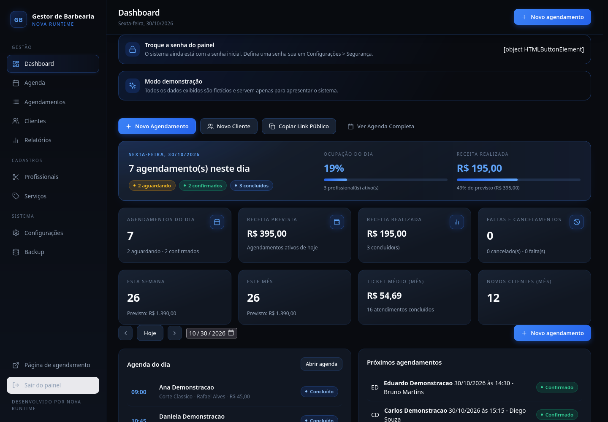
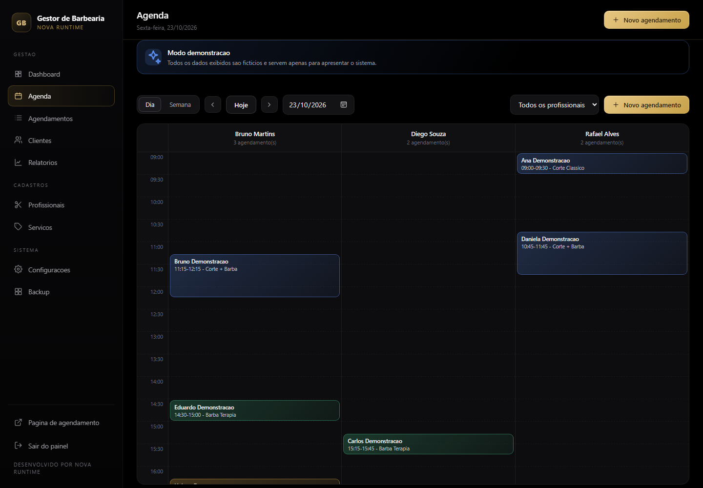
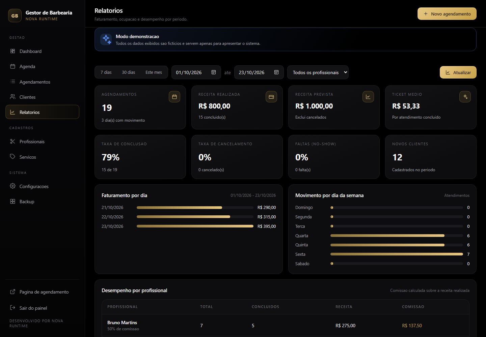
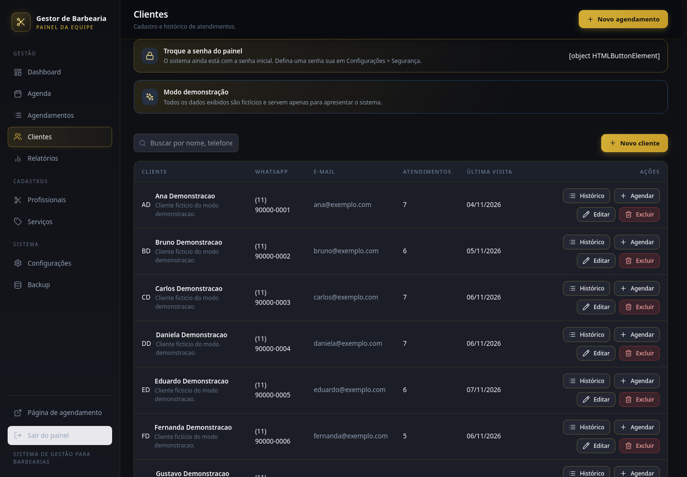
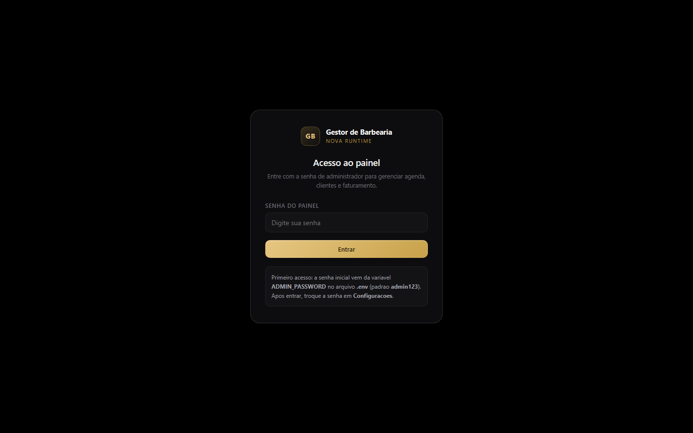

# Gestor de Barbearia

Sistema web completo para gestão de barbearias: agenda diária e semanal, cadastro de
clientes, profissionais e serviços, controle de faturamento, relatórios, backup e uma
**página pública de agendamento otimizada para celular**.

Interface em português com **identidade visual premium Preto e Azul** (Preto profundo `#090B10`,
superfícies `#111722`/`#182232` e acentos em azul `#2563EB`/`#3B82F6`), totalmente responsiva
para computador e celular. Arquitetura em **Node.js** com tipagem estrita **TypeScript**
(`tsconfig.json` e `server/types.ts`), sem dependências pesadas, com persistência em
**SQLite** (local) ou **Turso/libSQL** (produção na nuvem).

Desenvolvido por **Nova Runtime**.

---

## Capturas de tela

Todas as imagens abaixo são capturas reais da aplicação rodando em **modo demonstração**
(dados fictícios).

### Painel — Dashboard



### Agenda



### Relatórios



### Clientes



### Página pública de agendamento (celular)


### Acesso ao painel



---

## Funcionalidades

**Agenda e agendamentos**
- Agenda diária e semanal, com filtro por profissional.
- Criação, edição, confirmação, conclusão e cancelamento de agendamentos.
- **Bloqueio de agendamentos duplicados** no mesmo horário e profissional — garantido
  por uma instrução SQL atômica e por um índice único parcial no próprio banco, o que
  evita condições de corrida mesmo com acessos simultâneos.
- Controle de horários de funcionamento, jornada de cada profissional, pausas e folgas.
- Cálculo automático do horário de término com base na duração do serviço.

**Cadastros**
- Clientes (com busca por nome/telefone), profissionais (cor, comissão, jornada) e
  serviços (duração e preço).

**Financeiro e relatórios**
- Dashboard com agenda do dia, receita prevista e realizada, ocupação dos profissionais
  e serviços mais procurados.
- Relatórios por período, com totais, comissão por profissional e distribuição por dia
  da semana.

**Página pública de agendamento**
- Fluxo em 4 passos (serviço → profissional → horário → dados), pensado para o celular.
- Só exibe horários realmente livres; respeita folgas e dias fechados.
- Botão de contato direto no **WhatsApp** e link para o telefone da barbearia.
- Pode ser desativada a qualquer momento nas configurações.

**WhatsApp**
- Mensagens prontas de confirmação, lembrete e cancelamento, geradas a partir do
  agendamento e abertas no WhatsApp com um clique.

**Operação**
- Backup exportável/importável em JSON (modos *mesclar* e *substituir*).
- Health check em `/health` para monitoramento e deploy.
- Modo demonstração com dados fictícios (`npm run demo`).

---

## Tecnologias

| Camada | Escolha | Motivo |
| --- | --- | --- |
| Runtime | Node.js 22.5+ | `node:sqlite` nativo, sem compilações externas |
| Tipagem / Tipos | TypeScript (Strict) | Tipagem estrita de contratos de domínio (`server/types.ts`) e validação via `npm run typecheck` |
| Backend | HTTP nativo (`node:http`) + módulos ES | Rápido, leve, sem overhead de frameworks |
| Frontend | HTML + CSS + JavaScript (módulos ES) | SPA nativa com design tokens preto & azul e alta performance |
| Banco (local) | SQLite via `node:sqlite` | Zero configuração |
| Banco (produção) | Turso / libSQL via `@libsql/client` | Persistência real no plano gratuito do Render |
| Segurança | `node:crypto` (scrypt, HMAC-SHA256) | Criptografia forte para senhas e sessões |
| Hospedagem | Render (plano gratuito) | HTTPS e domínio `*.onrender.com` inclusos |

A escolha do banco é automática: se a variável `TURSO_DATABASE_URL` estiver definida, o
sistema usa o Turso; caso contrário, usa SQLite local. O mesmo código atende
desenvolvimento e produção.

---

## Instalação local

Requisitos: **Node.js 22.5 ou superior**.

```bash
git clone <URL-DO-SEU-REPOSITORIO>
cd "Gestao de Barbearia"
npm install
cp .env.example .env      # ajuste a senha do painel em ADMIN_PASSWORD
npm start
```

Acesse:

- Painel: <http://localhost:3000/>
- Agendamento público: <http://localhost:3000/agendar>

Na primeira execução o banco é criado em `data/barbearia.db` e a senha do painel passa a
ser a de `ADMIN_PASSWORD` (ou `admin123`, se você não definir). **Troque a senha em
Configurações → Segurança** no primeiro acesso — o painel exibe um aviso até isso ser feito.

Para acessar pelo celular na mesma rede Wi-Fi, o `npm start` mostra o endereço no banner
(mantenha `HOST=0.0.0.0`).

---

## Modo demonstração

Apresenta o sistema com **dados fictícios**, em um banco separado (`data/demo.db`), sem
tocar em nenhum dado real:

```bash
npm install
npm run demo
```

A interface mostra o selo *Modo demonstração* no painel e na página pública. Barbeiros,
clientes e agendamentos são gerados automaticamente e **não representam pessoas reais**.

---

## Testes e Verificação de Tipos

```bash
npm run typecheck       # Verificação estrita de tipos com TypeScript (tsc --noEmit)
npm test                # 121 verificações end-to-end (API, regras de negócio e segurança)
npm run test:turso      # 21 verificações de persistência com libSQL (sobrevive a reinício)
npm run test:responsive # 10 verificações de conformidade mobile (touch targets >= 44px, safe area)
npm run test:all        # Executa todas as suites de testes e validação de tipos
```

O teste `test:turso` sobe o servidor sobre um banco libSQL, grava dados, **reinicia o
servidor** e confirma que os registros continuam lá — o que valida a persistência usada
em produção.

---

## Variáveis de ambiente

| Variável | Obrigatória | Descrição |
| --- | --- | --- |
| `PORT` | não | Porta HTTP (padrão `3000`; o Render define automaticamente). |
| `HOST` | não | Interface de rede (padrão `0.0.0.0`). |
| `ADMIN_PASSWORD` | não | Senha inicial do painel. Se ausente, usa `admin123`. |
| `DATABASE_PATH` | não | Caminho do arquivo SQLite local. |
| `TURSO_DATABASE_URL` | em produção | URL do banco Turso (`libsql://...`). |
| `TURSO_AUTH_TOKEN` | em produção | Token de acesso do Turso. |
| `DEMO_MODE` | não | `1` ativa o modo demonstração com dados fictícios. |

Nunca coloque senhas ou tokens dentro do código. O arquivo `.env` é ignorado pelo Git;
todas as credenciais de produção ficam nas variáveis de ambiente do Render.

---

## Deploy gratuito (Render + Turso)

O passo a passo completo está em **[DEPLOY.md](DEPLOY.md)**. Resumo:

1. Crie um banco gratuito no [Turso](https://turso.tech) e copie a URL e o token.
2. Envie o projeto para o GitHub.
3. No [Render](https://render.com), use **New → Blueprint** e aponte para o repositório
   (o arquivo [`render.yaml`](render.yaml) já descreve o serviço).
4. Informe `TURSO_DATABASE_URL` e `TURSO_AUTH_TOKEN` quando solicitado.
5. O Render entrega HTTPS e um domínio gratuito no formato `https://SEU-APP.onrender.com`.

### Atualizando o sistema depois de publicado

O serviço está configurado com `autoDeploy`. Para publicar uma alteração:

```bash
git add .
git commit -m "Descrição da melhoria"
git push
```

O Render detecta o push, reconstrói e publica sozinho. Como os dados ficam no **Turso**
(e não no disco do Render), **nenhum cliente, profissional ou agendamento é perdido** nos
deploys e reinícios.

---

## Limitações do plano gratuito

O sistema foi pensado para rodar **sem custo**, mas o plano gratuito tem limites
(valores verificados em outubro de 2026 — confirme em
<https://render.com/pricing> e <https://turso.tech/pricing>):

- **O serviço hiberna** após 15 minutos sem acesso. O próximo acesso demora
  cerca de **um minuto** para responder (cold start), enquanto o Render exibe uma
  página de carregamento. Um monitor externo chamando `/health` periodicamente
  mantém a aplicação acordada.
- **Disco efêmero**: arquivos gravados no servidor são apagados a cada deploy ou
  reinício. Por isso o banco fica no **Turso** — veja a seção *Banco de dados* abaixo.
- Recursos modestos (**cerca de 512 MB de RAM e 0,1 CPU**), **750 horas de
  instância** e **5 GB de tráfego** por mês. Para uma barbearia, é suficiente.
- O plano gratuito do **Turso** inclui 100 bancos, **5 GB de armazenamento**,
  500 milhões de linhas lidas e 10 milhões de linhas gravadas por mês — sem
  cartão de crédito.

Todos os serviços usados têm plano gratuito. Nenhum recurso pago é necessário.

---

## Segurança

- Senha do painel com **scrypt** (salt aleatório) e comparação em tempo constante.
- Sessão assinada com **HMAC-SHA256**, em cookie `HttpOnly`, `SameSite=Lax` e `Secure`
  quando servido por HTTPS (suporte a `SESSION_SECRET` customizado via ambiente).
- **Proteção CSRF / Origin Validation** em todas as requisições mutantes (`POST`, `PUT`, `PATCH`, `DELETE`).
- **Ocultação de detalhes internos em produção**: erros e exceções não vazam stack traces ou schemas internos (`NODE_ENV=production`).
- Cabeçalhos de segurança: `Content-Security-Policy`, `Strict-Transport-Security`,
  `X-Frame-Options`, `X-Content-Type-Options` e `Referrer-Policy`.
- **Rate limiting** por IP no login e nos endpoints públicos de agendamento.
- Validação e normalização de todas as entradas na API.
- Segredos (`session_secret`, hash de senha) nunca aparecem nas respostas nem no backup.
- IP real e protocolo detectados corretamente atrás do proxy do Render
  (`x-forwarded-for` / `x-forwarded-proto`).

---

## Estrutura do projeto

```
.
├── public/                 # Front-end (sem build) servido pelo próprio Node
│   ├── css/app.css         # Tema escuro premium
│   ├── js/app.js           # Painel (SPA com roteamento por hash)
│   ├── js/agendar.js       # Página pública de agendamento
│   └── index.html, agendar.html, 404.html
├── server/                 # Back-end
│   ├── server.js           # Servidor HTTP, roteador e banner
│   ├── db.js               # Driver duplo: node:sqlite / Turso (libSQL)
│   ├── availability.js     # Regras de horários, folgas e conflitos
│   ├── appointments.js     # Regras de negócio dos agendamentos
│   ├── auth.js             # Sessão, senha e autenticação
│   ├── security.js         # Cabeçalhos, rate limit e detecção de proxy
│   ├── demo.js             # Dados fictícios do modo demonstração
│   └── routes/             # Endpoints da API, por domínio
├── scripts/demo.mjs        # Atalho para iniciar em modo demonstração
├── tests/                  # Testes end-to-end e de persistência
├── docs/screenshots/       # Capturas usadas neste README
├── render.yaml             # Blueprint de deploy no Render
└── .env.example            # Modelo das variáveis de ambiente
```

---

## Licença

Projeto de uso pessoal e de portfólio, desenvolvido por **Nova Runtime**.
Consulte o autor antes de reutilizar comercialmente.
