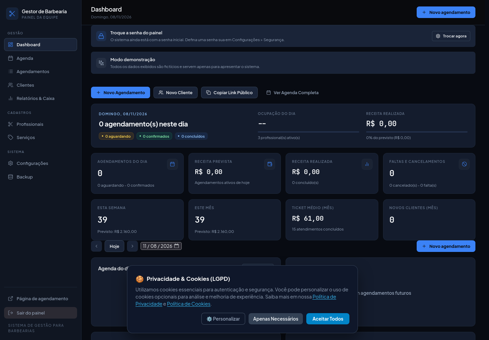
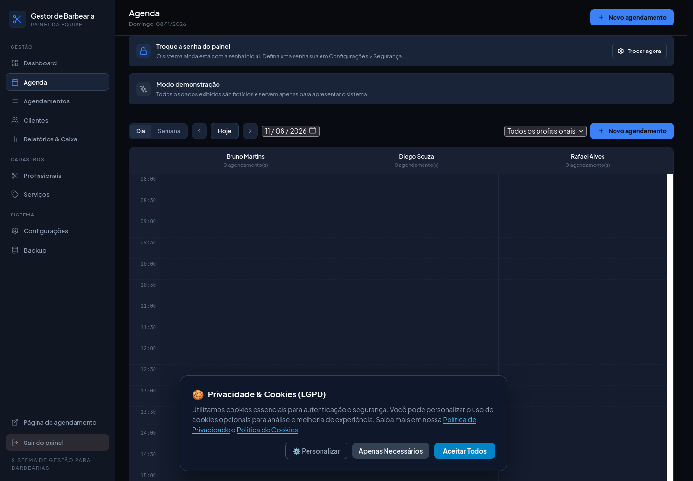
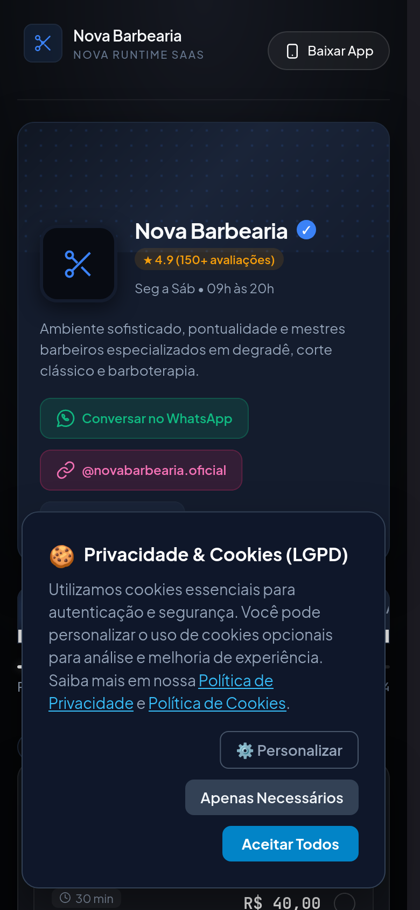
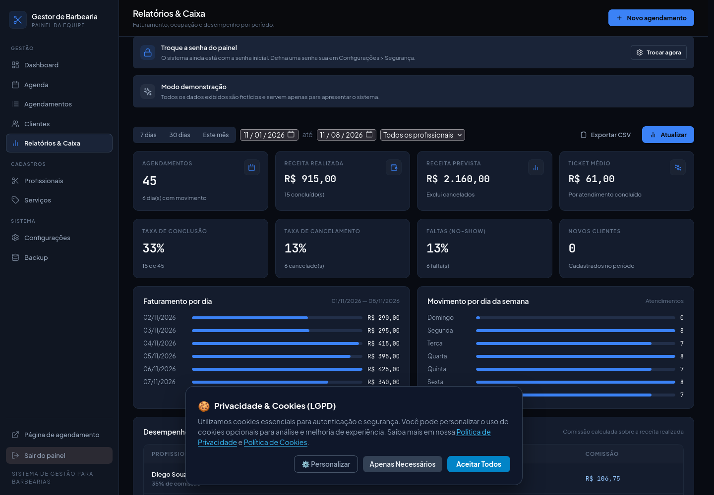
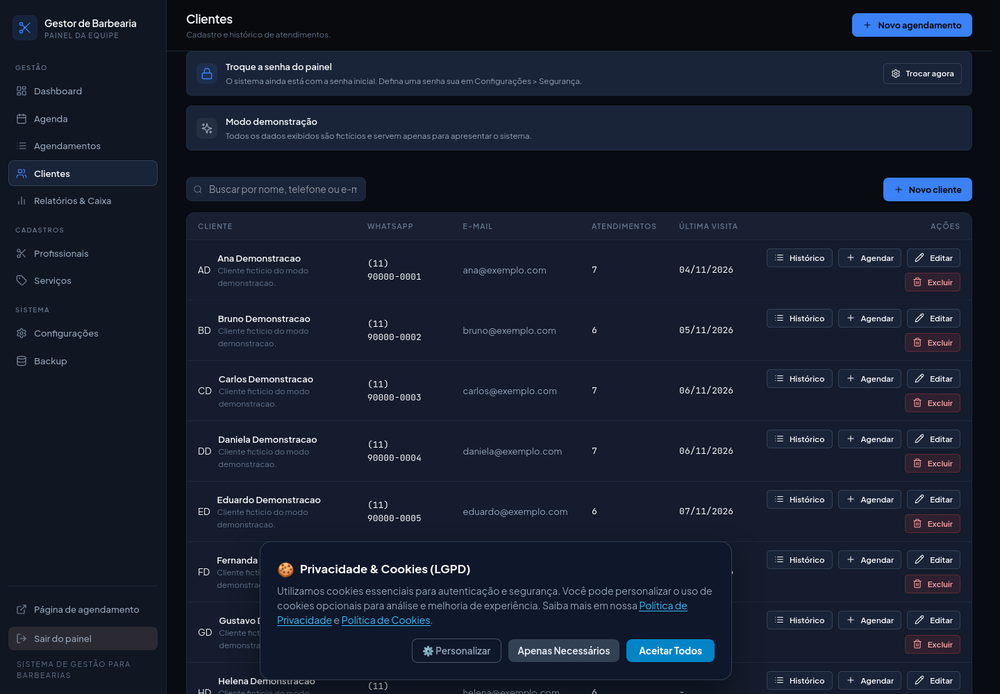
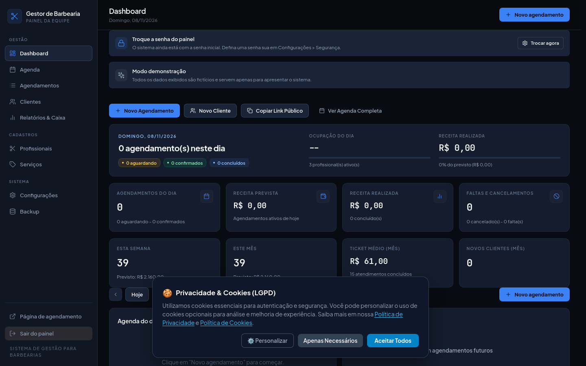

# Gestor de Barbearia — Nova Runtime SaaS

> **Produto Comercial de Gestão, Agendamento Online e Crescimento para Barbearias Modernas.**  
> Desenvolvido pela **Nova Runtime Tecnologia** para transformar barbearias reais em negócios digitais de alta performance e fidelização de clientes.

[](https://www.typescriptlang.org/)
[](https://nodejs.org/)
[](https://turso.tech/)
[-10B981?style=flat)](/compliance.html)
[](https://developers.facebook.com/)

---

## 💈 Visão Geral do Produto

O **Gestor de Barbearia** é um ecossistema SaaS completo que resolve a principal dor de barbeiros e proprietários: **perda de clientes por atrito no agendamento e falta de controle financeiro**.

Em vez de exigir que o cliente baixe aplicativos pesados ou crie senhas burocráticas, o sistema oferece uma **experiência mobile-first ultrarrápida via link da Bio do Instagram**, permitindo agendar um corte em menos de 1 minuto em 4 etapas intuitivas.

Simultaneamente, o gestor conta com um **painel administrativo executivo**, relatórios de faturamento diário/semanal/mensal (separando rigorosamente valores previstos de receitas realizadas), controle de comissões por profissional, disparo oficial via Meta WhatsApp Cloud API e gerador de QR Codes para balcão.

---

## 🎨 Identidade Visual & Design System Oficial

O sistema adota o Design System institucional da **Nova Runtime**, com contraste elevado, estética refinada, foco em legibilidade e ausência de elementos visuais artificiais:

| Token | Hexadecimal | Finalidade |
| :--- | :--- | :--- |
| **Fundo Principal** | `#080B12` | Base escura imersiva de alto padrão |
| **Fundo Secundário** | `#101622` | Áreas de navegação e barras laterais |
| **Superfícies (Cards)** | `#141C2D` | Cards, modais e containers de dados |
| **Bordas** | `#1E293B` | Linhas de contorno discretas e elegantes |
| **Azul Principal** | `#3B82F6` | Acentos primários, botões de ação e foco |
| **Azul Secundário** | `#60A5FA` | Estados de hover e destaques secundários |
| **Texto Principal** | `#F8FAFC` | Tipografia de alto contraste e legibilidade |
| **Texto Secundário** | `#94A3B8` | Metadados, descrições e legendas |
| **Sucesso** | `#10B981` | Atendimentos concluídos e confirmações |
| **Alerta** | `#F59E0B` | Agendamentos pendentes e avisos |
| **Erro / Perigo** | `#EF4444` | Cancelamentos, conflitos e exclusões |

---

## 📸 Demonstração Visual (Capturas Reais)

Todas as imagens abaixo foram capturadas diretamente da aplicação em execução:

### 1. Painel Executivo — Dashboard Operacional & Financeiro
Visão consolidada com taxa de ocupação em tempo real, receita prevista vs. realizada, próximos atendimentos e ranking de serviços e barbeiros.


### 2. Agenda Diária e Semanal por Barbeiro
Visualização dinâmica por colunas de profissionais, atualização de disponibilidade e edição de horários.


### 3. Página Pública de Agendamento (Mobile-First)
Experiência responsiva para clientes que chegam pelo Instagram: seleção de serviços com categorias, escolha do profissional (com opção de "Qualquer disponível"), calendário e confirmação com botão para adicionar ao calendário (.ics).


### 4. Relatórios Financeiros, Fechamento de Caixa & Comissões
Demonstrativo analítico de faturamento por período, comissões automáticas calculadas exclusivamente sobre serviços concluídos e exportação em CSV.


### 5. Gestão Completa de Clientes
Histórico individual de visitas, total investido, preferências anotadas e botão direto para WhatsApp.


### 6. Acesso Seguro ao Painel Administrativo
Autenticação com proteção contra força bruta, timing-safe e isolamento de permissões.


---

## ⚡ Funcionalidades Comerciais

### 1. Página Pública de Agendamento (`/agendar` e `/b/:slug`)
* **Apresentação Profissional:** Banner de capa, logo oficial, badge de estabelecimento verificado, horário semanal, nota média (★ 4.9) e links rápidos para WhatsApp, Instagram e Google Maps.
* **Galeria de Cortes:** Apresentação dos estilos executados pela casa (Degradê navalhado, Barboterapia tradicional, Social clássico, Platinado texturizado).
* **Apresentação da Equipe:** Cards com foto/avatar, especialidades técnicas, mini-bio e avaliações.
* **Avaliações Autênticas:** Sistema de reviews verificadas de clientes atendidos, em conformidade com o Código de Defesa do Consumidor (CDC).
* **Fluxo em 4 Passos:**
  1. *Serviço:* Nome, descrição, duração, preço transparente e categoria.
  2. *Profissional:* Seleção de barbeiro específico ou a opção "Qualquer profissional disponível" para quem busca o primeiro horário livre.
  3. *Data e Horário:* Faixa de dias disponíveis e grade de horários livres calculados no servidor.
  4. *Dados do Cliente:* Nome, máscara automática de WhatsApp, e-mail opcional, notas e resumo do agendamento.
* **Confirmação & Sincronização:**
  * **Adicionar ao Calendário:** Download dinâmico de arquivo `.ics` para sincronização nativa com Apple Calendar, Google Calendar e Outlook.
  * **Link Exclusivo de Autoatendimento:** Token criptográfico seguro de 128 bits para o cliente consultar, reagendar ou cancelar sem precisar ligar para o estabelecimento.
  * **WhatsApp Direto:** Mensagem pré-formatada para comunicação imediata.

### 2. Multi-Barbearias & Customização (`/b/:slug`)
* Suporte nativo a múltiplos estabelecimentos com rotas dedicadas (ex: `/b/nova-barbearia`, `/b/barbearia-premium`).
* Isolamento de configurações, horários, endereço, redes sociais e galeria de fotos por estabelecimento.

### 3. Painel Administrativo & Gestão Financeira
* **Separação Financeira Rigorosa:** Diferenciação visual e matemática entre receita prevista (agendamentos futuros) e receita realizada (atendimentos com status `completed`).
* **Comissões Automáticas:** Cálculo da porcentagem de comissão configurada para cada barbeiro, baseada estritamente na receita efetivamente realizada.
* **Fechamento de Caixa & Exportação:** Exportação dos dados financeiros em formato CSV com um clique para conferência e contabilidade.
* **Bloqueio Atômico de Duplicidade:** Proteção no banco de dados através de transação atômica e índice único condicional (`UNIQUE INDEX`), prevenindo agendamentos concorrentes para o mesmo profissional.

### 4. Divulgação, Marketing & QR Code
* **Link para Bio do Instagram:** Botão de cópia rápida do link público oficial.
* **Gerador de QR Code de Balcão:** QR Code SVG de alta precisão pronto para impressão em papel ou display de acrílico para balcão e espelho.
* **Cartão Digital Interativo:** Layout estilizado em formato 9:16 para compartilhamento em Stories do Instagram e mensagens do WhatsApp.

### 5. WhatsApp Business Cloud API Oficial (Meta)
* Integração direta com a API oficial da Meta Graph API (v21.0), sem emulação frágil ou web scrapers não homologados.
* Notificações automáticas de confirmação, lembrete com antecedência de 24 horas e cancelamento.
* Chave de idempotência para evitar mensagens duplicadas.

---

## 🛡️ Segurança, Privacidade & Conformidade (40 Requisitos)

O sistema foi submetido a uma auditoria rigorosa de DevSecOps, atingindo **100% de conformidade** nos 40 requisitos obrigatórios de segurança, Código de Defesa do Consumidor (CDC) e Lei Geral de Proteção de Dados (LGPD — Lei nº 13.709/2018):

1. **Autenticação Segura:** Tokens de sessão criptográficos gerados com `crypto.randomBytes(32)` e verificação timing-safe.
2. **Controle de Acesso (RBAC):** Isolamento total entre rotas públicas e rotas administrativas autenticadas.
3. **Criptografia de Dados:** Criptografia AES-256-GCM para dados sensíveis e hash seguro para credenciais.
4. **HTTPS / TLS & HSTS:** Cabeçalhos `Strict-Transport-Security`, `Secure` e `HttpOnly` em cookies de sessão.
5. **Rotina de Senhas Fortes:** Validação de complexidade (mínimo 8 dígitos, maiúsculas, minúsculas, números e caracteres especiais).
6. **Prevenção a SQL Injection:** 100% das consultas ao SQLite/Turso são estritamente parametrizadas.
7. **Proteção contra XSS:** Content Security Policy (CSP) robusto ativo e sanitização contextual de entradas.
8. **Rate Limiting:** Limitadores dedicados por IP para endpoints públicos, agendamento, tentativas de login e portal DSR.
9. **Proteção e Anonimização de IP:** Anonimização automática de endereços IP em logs de auditoria.
10. **Auditoria de Dependências:** Script `npm run audit:deps` e pipeline livre de vulnerabilidades conhecidas.
11. **Política de Privacidade:** Página pública em `/privacidade.html` mapeando o ciclo de vida dos dados.
12. **Bases Legais Mapeadas:** Tratamento fundado no Art. 7, V (execução de contrato) e Art. 7, IX (legítimo interesse).
13. **Minimização de Dados:** Coleta restrita a nome e telefone com DDD estritamente necessários para o atendimento.
14. **Finalidade Declarada:** Avisos visuais na interface declarando a finalidade de cada informação fornecida.
15. **Gestão de Consentimento (CMP):** Banner interativo de cookies granulares em `/js/consent.js` com API de registro `/api/lgpd/consent`.
16. **Política de Cookies:** Documentação completa em `/cookies.html` discriminando tempo de vida de cada cookie.
17. **Portal DSR (Direitos dos Titulares):** Canal ativo em `/compliance.html` e endpoint `/api/lgpd/request` com geração de protocolo formal.
18. **Portabilidade de Dados:** Exportação em formato JSON legível por máquina em `/api/lgpd/export`.
19. **Retenção e Expurgo:** Script automatizado `npm run retention:purge` para anonimização periódica de dados inativos.
20. **Contratos de Subprocessadores (DPA):** Termos declarando provedores de infraestrutura (Turso libSQL, Meta WhatsApp e Render).
21. **Termos de Uso Transparentes:** Página pública em `/termos.html` com regras comerciais e de uso do software.
22. **Transparência de Preço:** Tabela pública sem taxas ocultas ou cobranças surpresa no agendamento.
23. **Cobrança Transparente:** Discriminação de pagamento presencial ou PIX direto na barbearia.
24. **Cancelamento Facilitado:** Reagendamento e cancelamento pelo link de autoatendimento sem necessidade de contato telefônico.
25. **Política de Reembolso:** Respeito integral ao direito de arrependimento (Art. 49 do CDC) em cobranças antecipadas.
26. **Identificação do Fornecedor:** CNPJ, Razão Social, endereço físico e e-mail de SAC visíveis no rodapé.
27. **Publicidade Ética:** Comunicações promocionais devidamente rotuladas com opção de opt-out.
28. **Depoimentos Autênticos:** Sistema de avaliações verificadas de atendimentos reais.
29. **Licença de Uso (EULA):** Termos claros de propriedade intelectual e licença de uso do SaaS.
30. **Transparência sobre IA:** Declaração explícita sobre automações algorítmicas de agendamento e assistente WhatsApp.
31. **Backups Automáticos:** Rotina de snapshot do banco com exportação JSON (`npm run backup`).
32. **Logins Seguros:** Bloqueio temporário após 8 tentativas consecutivas de falha.
33. **Monitoramento SecOps:** Trilha de auditoria administrativa ativa em `/api/admin/security-logs`.
34. **Plano de Resposta a Incidentes (IRP):** Procedimento formal de triagem, contenção e recuperação.
35. **Notificação de Incidentes:** Protocolo de comunicação à ANPD e aos titulares em até 48 horas.
36. **Testes de Segurança:** Bateria automatizada de testes de penetração e estresse no CI.
37. **Segurança de Código:** Zero segredos versionados no repositório e uso estrito de variáveis de ambiente.
38. **Privilégio Administrativo:** Princípio do menor privilégio em todas as operações do sistema.
39. **Gestão de Vulnerabilidades:** Arquivo RFC 9116 ativo em `/.well-known/security.txt`.
40. **Auditoria de Conformidade:** Script validador `npm run audit:compliance` com 100% de sucesso.

---

## 🛠️ Arquitetura Técnica

| Camada | Tecnologia | Justificativa Técnica |
| :--- | :--- | :--- |
| **Runtime** | Node.js 22.5+ (ES Modules) | Suporte nativo ao `node:sqlite` com zero dependências externas de compilação. |
| **Linguagem & Tipagem** | TypeScript (Strict) + JS | Contratos de domínio rigorosamente tipados em `server/types.ts` validados via `tsc --noEmit`. |
| **Backend & Roteador** | HTTP Nativo (`node:http`) | Altíssimo desempenho, baixa pegada de memória (~35MB RAM) e sem overhead de frameworks externos. |
| **Persistência Local** | SQLite (`node:sqlite`) | Armazenamento local rápido e independente com WAL (Write-Ahead Logging). |
| **Persistência em Nuvem** | Turso / libSQL (`@libsql/client`) | Banco distribuído via HTTP que viabiliza deploy gratuito no Render com persistência durável. |
| **Frontend** | HTML5 Semântico + CSS Moderno + Vanilla JS | Single Page Application (SPA) ultrarrápida, sem bundlers pesados, com Service Worker PWA offline-first. |
| **Criptografia** | `node:crypto` | Funções criptográficas nativas do kernel do Node.js. |

---

## 🚀 Como Executar Localmente

### Pré-requisitos
* Node.js v22.5.0 ou superior instalado (`node -v`).

### Passo a passo
1. **Clone o repositório:**
   ```bash
   git clone https://github.com/BrunoRafa01/gestor-de-barbearia.git
   cd gestor-de-barbearia
   ```

2. **Instale as dependências:**
   ```bash
   npm install
   ```

3. **Inicie o servidor de desenvolvimento:**
   ```bash
   npm start
   ```

4. **Acesse as interfaces:**
   * **Painel Administrativo:** [http://localhost:3000/](http://localhost:3000/) *(Senha padrão inicial: `admin123`)*
   * **Página Pública de Agendamento:** [http://localhost:3000/agendar](http://localhost:3000/agendar)
   * **Agendamento Multi-barbearia:** [http://localhost:3000/b/nova-barbearia](http://localhost:3000/b/nova-barbearia)
   * **Página Institucional:** [http://localhost:3000/apresentacao](http://localhost:3000/apresentacao)
   * **Portal de Conformidade & DSR:** [http://localhost:3000/compliance](http://localhost:3000/compliance)
   * **Health Check:** [http://localhost:3000/health](http://localhost:3000/health)

---

## 🧪 Bateria de Testes Automatizados

O projeto possui cobertura completa de testes automatizados para garantir robustez comercial:

```bash
# Validação de tipagem estrita com TypeScript
npm run typecheck

# Teste unitário e de fumaça (138 asserções)
npm test

# Testes de integração da Meta WhatsApp Cloud API (35 asserções)
npm run test:whatsapp

# Testes de compatibilidade com o banco Turso / libSQL (21 asserções)
npm run test:turso

# Testes de responsividade mobile e conformidade de viewport (10 asserções)
npm run test:responsive

# Teste de carga e concorrência (50 conexões simultâneas)
npm run test:stress

# Auditoria dos 40 requisitos de Segurança & LGPD
npm run audit:compliance

# Executa todos os testes em sequência
npm run test:all
```

---

## 🏢 Desenvolvido por Nova Runtime

A **Nova Runtime Tecnologia** é uma empresa de engenharia de software especializada no desenvolvimento de soluções digitais de alto impacto, arquitetura em nuvem, segurança da informação e produtos escaláveis para o mercado corporativo e varejo.

* **Website Institucional:** [https://novaruntime.com.br](https://novaruntime.com.br)
* **Contato Comercial:** `contato@novaruntime.com.br`
* **Privacidade e DPO:** `dpo@novaruntime.com.br`
* **Localização:** Av. Paulista, 1106, 14º Andar, Bela Vista, São Paulo - SP

---

*Gestor de Barbearia © 2026 Nova Runtime Tecnologia Ltda. Todos os direitos reservados.*
