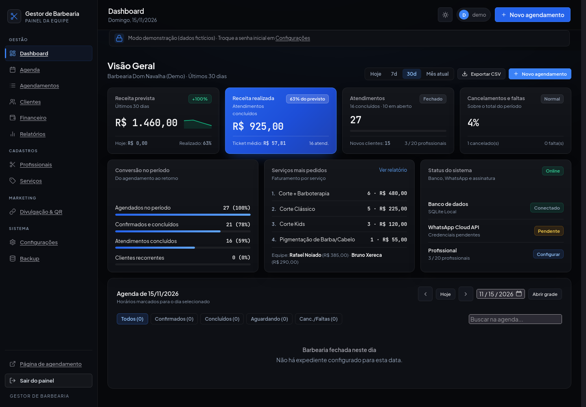
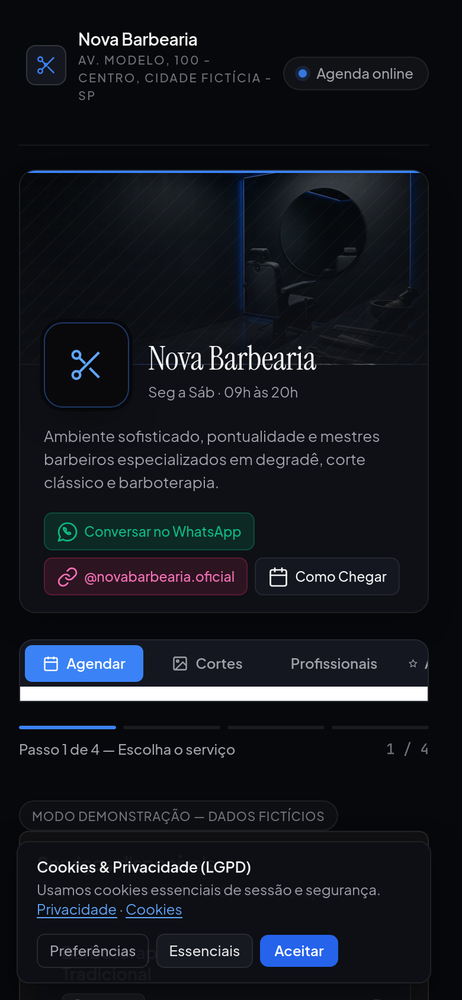
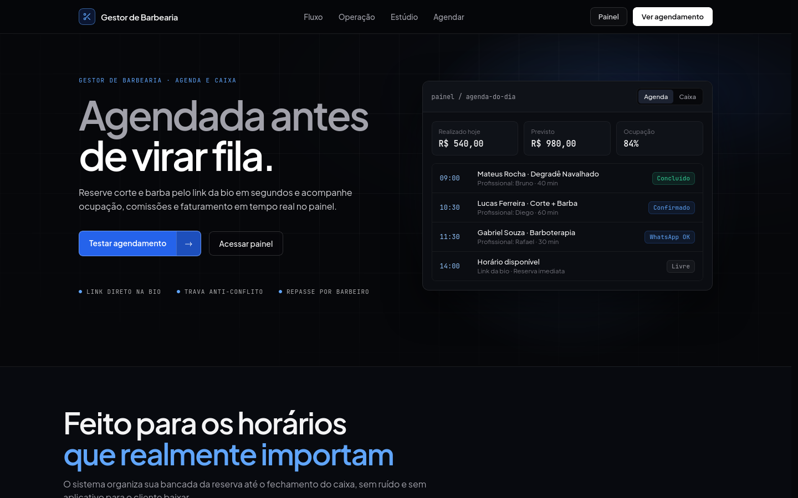
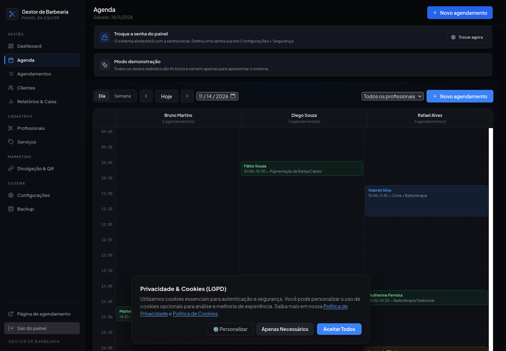
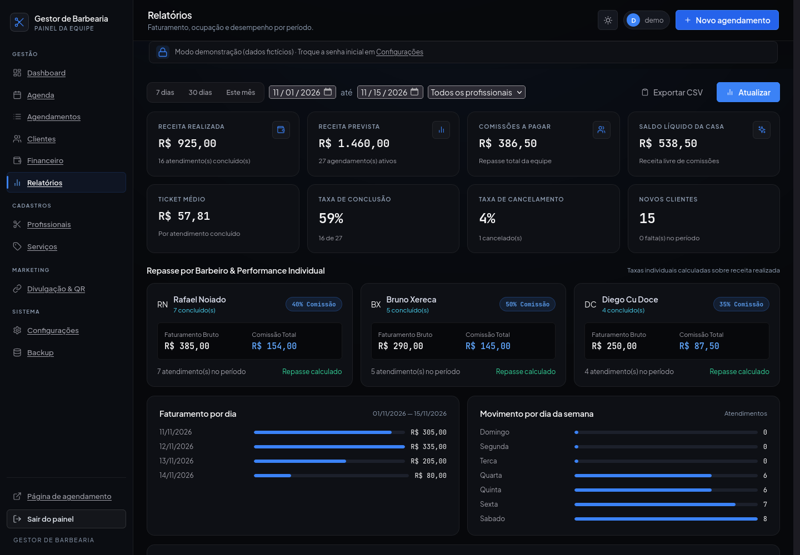

# Gestor de Barbearia — Nova Runtime SaaS

> **Produto Comercial de Gestão, Agendamento Online e Crescimento para Barbearias Modernas.**  
> Desenvolvido pela **Nova Runtime Tecnologia** para transformar barbearias reais em negócios digitais de alta performance e fidelização de clientes.

[](https://www.typescriptlang.org/)
[](https://nodejs.org/)
[](https://turso.tech/)
[](/compliance.html)
[](https://developers.facebook.com/)

---

## 💈 Visão Geral do Produto

O **Gestor de Barbearia** é um ecossistema SaaS completo que resolve a principal dor de barbeiros e proprietários: **perda de clientes por atrito no agendamento e falta de controle financeiro**.

Em vez de exigir que o cliente baixe aplicativos pesados ou crie senhas burocráticas, o sistema oferece uma **experiência mobile-first ultrarrápida via link da Bio do Instagram**, permitindo agendar um corte em menos de 1 minuto em 4 etapas intuitivas.

Simultaneamente, o gestor conta com um **painel administrativo executivo**, relatórios de faturamento diário/semanal/mensal (separando rigorosamente valores previstos de receitas realizadas), controle de comissões por profissional, disparo oficial via Meta WhatsApp Cloud API e gerador de QR Codes para balcão.

---

## 🎨 Identidade Visual & Design System Oficial

O sistema adota um Design System em **Preto Obsidiana + Azul Limpo** focado em legibilidade, camadas tonais, tipografia `tabular-nums` e ausência de ruído visual:

| Token | Valor | Finalidade |
| :--- | :--- | :--- |
| **Fundo Principal (`--bg`)** | `#07080B` / `#09090B` | Base escura em preto obsidiana |
| **Sidebar (`--bg-secondary`)** | `#0B0C0F` | Navegação lateral e cabeçalhos |
| **Superfícies (`--surface`)** | `#0E1015` / `#111216` | Cards, painéis bento e tabelas |
| **Elevação (`--surface-2`)** | `#17181E` | Abas ativas, modais e hover |
| **Bordas (`--border`)** | `rgba(255, 255, 255, 0.06)` | Linhas divisórias *hairline* sutis |
| **Azul Principal (`--accent`)** | `#3B82F6` / `#2563EB` | Ações primárias, seleção e gráficos |
| **Azul Destaque (`--accent-hover`)** | `#60A5FA` | Preços, links, hover e curvas SVG |
| **Texto Principal (`--text`)** | `#F4F4F5` | Tipografia de alto contraste |
| **Texto Secundário (`--text-dim`)** | `#A1A1AA` | Metadados, subtítulos e legendas |
| **Sucesso / Alerta / Erro** | `#34D399` · `#FBBF24` · `#FB7185` | Pílulas de status translúcidas |

---

## ✨ Experiência de Produto & Interfaces

### 1. Painel Executivo — Bento Grid de 3 Colunas (`/`)
Layout modular em duas linhas de 3 colunas com atualização dinâmica:
* **Linha 1:** *Resumo de Hoje* (receita realizada + ações rápidas), *Faturamento & Movimento* (gráfico SVG de duas curvas em `#3B82F6`/`#60A5FA`) e *Capacidade & Turno* (barra de ocupação).
* **Linha 2:** *Metas & Indicadores* (anéis circulares SVG), *Status dos Agendamentos* (gráfico donut dinâmico) e *Próximos na Agenda*.


### 2. Página Pública de Agendamento Temática (`/agendar`)
Estúdio de barbearia em Preto Obsidiana + Azul com fotografia editorial na capa (`public/img/barber-studio-hero.jpg`), selo **Agenda online**, menu de serviços com duração em `JetBrains Mono` e valores em `tabular-nums`, sem necessidade de baixar aplicativo.


### 3. Apresentação Cinética & Interativa (`/apresentacao.html`)
Landing page com transição atmosférica **Preto → Azul Elétrico → Branco Gelo**:
* **Hero 3D interativo:** camadas isométricas com paralaxe do cursor, *spotlight* e ticker ao vivo.
* **Fluxo técnico em 4 colunas:** diagramas isométricos em SVG responsivos ao hover.
* **Telemetria interativa:** seletor `7d | 30d | 90d`, mapa de calor por horário (*dot-matrix*) e resumo clicável de bancada.
* **Galeria de Estúdio:** fotografias editoriais em `public/img/barber-chair-studio.jpg` e `public/img/barber-craft-tools.jpg`.


### 4. Agenda, Financeiro, Clientes & Páginas LGPD
* **Agenda & Relatórios:** grade por barbeiro, fechamento de caixa e cálculo automático de comissões sobre atendimentos concluídos.
* **QR Code & Divulgação:** gerador SVG ISO/IEC 18004 escaneável diretamente no painel (`Divulgação & QR`) para link da bio e balcão.
* **Páginas Legais & DSR:** `/compliance.html`, `/privacidade.html`, `/termos.html`, `/cookies.html`, `/transparencia.html` e banner de cookies unificados no tema escuro Preto + Azul.



---

## ⚡ Funcionalidades Comerciais

### 1. Página Pública de Agendamento (`/agendar` e `/b/:slug`)
* **Apresentação Profissional:** Banner de capa, logo oficial, horário dinâmico de atendimento, nota média e links rápidos para WhatsApp, Instagram e Google Maps.
* **Galeria de Cortes:** Apresentação dos estilos executados pela casa (Degradê navalhado, Barboterapia tradicional, Social clássico, Platinado texturizado).
* **Apresentação da Equipe:** Cards com foto/avatar, especialidades técnicas, mini-bio e avaliações.
* **Avaliações de Clientes:** Espaço para registro de avaliações públicas na página da barbearia.
* **Fluxo em 4 Passos:**
  1. *Serviço:* Nome, descrição, duração, preço transparente e categoria.
  2. *Profissional:* Seleção de barbeiro específico ou a opção "Qualquer profissional disponível" para quem busca o primeiro horário livre.
  3. *Data e Horário:* Faixa de dias disponíveis e grade de horários livres calculados no servidor.
  4. *Dados do Cliente:* Nome, máscara automática de WhatsApp, e-mail opcional, notas e resumo do agendamento.
* **Confirmação & Sincronização:**
  * **Adicionar ao Calendário:** Download dinâmico de arquivo `.ics` para sincronização nativa com Apple Calendar, Google Calendar e Outlook.
  * **Link Exclusivo de Autoatendimento:** Token criptográfico seguro de 128 bits para o cliente consultar, reagendar ou cancelar sem precisar ligar para o estabelecimento.
  * **WhatsApp Direto:** Mensagem pré-formatada para comunicação imediata.

### 2. Multi-Barbearias & Customização (`/b/:slug`)
* Suporte nativo a múltiplos estabelecimentos com rotas dedicadas (ex: `/b/nova-barbearia`, `/b/barbearia-premium`).
* Isolamento de configurações, horários, endereço, redes sociais e galeria de fotos por estabelecimento.

### 3. Painel Administrativo & Gestão Financeira
* **Separação Financeira Rigorosa:** Diferenciação visual e matemática entre receita prevista (agendamentos futuros) e receita realizada (atendimentos com status `completed`).
* **Comissões Automáticas:** Cálculo da porcentagem de comissão configurada para cada barbeiro, baseada estritamente na receita efetivamente realizada.
* **Fechamento de Caixa & Exportação:** Exportação dos dados financeiros em formato CSV com um clique para conferência e contabilidade.
* **Bloqueio Atômico de Duplicidade:** Proteção no banco de dados através de transação atômica e índice único condicional (`UNIQUE INDEX`), prevenindo agendamentos concorrentes para o mesmo profissional.

### 4. Divulgação, Marketing & QR Code
* **Link para Bio do Instagram:** Botão de cópia rápida do link público oficial.
* **Gerador de QR Code de Balcão:** QR Code SVG de alta precisão pronto para impressão em papel ou display de acrílico para balcão e espelho.
* **Cartão Digital Interativo:** Layout estilizado em formato 9:16 para compartilhamento em Stories do Instagram e mensagens do WhatsApp.

### 5. WhatsApp Business Cloud API Oficial (Meta)
* Integração direta com a API oficial da Meta Graph API (v21.0), sem emulação frágil ou web scrapers não homologados.
* Notificações automáticas de confirmação, lembrete com antecedência de 24 horas e cancelamento.
* Chave de idempotência para evitar mensagens duplicadas.

---

## 🛡️ Segurança, Privacidade & Controles LGPD / CDC

O sistema implementa **controles técnicos alinhados à LGPD (Lei nº 13.709/2018) e ao CDC**, separando verificações automatizadas em código de itens documentais ou operacionais do estabelecimento:

* **Autenticação e Sessão:** Senhas com hash `scrypt` (salt aleatório), comparação `timingSafeEqual`, cookies `HttpOnly` assinados com HMAC-SHA256 e troca obrigatória da senha provisória no primeiro acesso.
* **Controle de Acesso e Anti-Abuso:** Isolamento entre rotas públicas (`auth: false`) e painel administrativo (`assertAuthenticated`), proteção CSRF por `Origin`, CSP (`script-src 'self'`), HSTS em HTTPS e rate limiters por IP.
* **Prevenção a SQL Injection e XSS:** Consultas parametrizadas no SQLite / Turso e sanitização de entradas de texto.
* **Privacidade e Titulares (LGPD):** Páginas públicas (`/privacidade.html`, `/cookies.html`, `/termos.html`, `/compliance.html`), banner de consentimento (`/js/consent.js`), portal de solicitações DSR (`/api/lgpd/request`) e exportação JSON (`/api/lgpd/export`).
* **Backup e Auditoria:** Backup manual via `npm run backup` (`scripts/backup-db.mjs`) ou exportação/restauração JSON no painel (`/api/backup`), trilha de eventos em `/api/admin/security-logs`, arquivo `/.well-known/security.txt` e verificação técnica via `npm run audit:compliance`.
* **Itens dependentes de operação (autodeclarados/pendentes):** Revisão jurídica dos textos legais, preenchimento dos dados empresariais (CNPJ/razão social do estabelecimento quando aplicável), formalização de contratos DPA e eventual adição de SAST/pentest dedicado no CI.

---

## 🛠️ Arquitetura Técnica

| Camada | Tecnologia | Justificativa Técnica |
| :--- | :--- | :--- |
| **Runtime** | Node.js 22.5+ (ES Modules) | Suporte nativo ao `node:sqlite` com zero dependências externas de compilação. |
| **Linguagem & Tipagem** | TypeScript (Strict) + JS | Contratos de domínio rigorosamente tipados em `server/types.ts` validados via `tsc --noEmit`. |
| **Backend & Roteador** | HTTP Nativo (`node:http`) | Altíssimo desempenho, baixa pegada de memória (~35MB RAM) e sem overhead de frameworks externos. |
| **Persistência Local** | SQLite (`node:sqlite`) | Armazenamento local rápido e independente com WAL (Write-Ahead Logging). |
| **Persistência em Nuvem** | Turso / libSQL (`@libsql/client`) | Banco distribuído via HTTP que viabiliza deploy gratuito no Render com persistência durável. |
| **Frontend** | HTML5 Semântico + CSS Design System + Vanilla JS | Interface SPA leve, sem bundlers pesados, com cache-busting e carregamento direto sem dependência de instalação PWA. |
| **Criptografia** | `node:crypto` | Funções criptográficas nativas do kernel do Node.js. |

---

## 🚀 Como Executar Localmente

### Pré-requisitos
* Node.js v22.5.0 ou superior instalado (`node -v`).

### Passo a passo
1. **Clone o repositório:**
   ```bash
   git clone https://github.com/BrunoRafa01/gestor-de-barbearia.git
   cd gestor-de-barbearia
   ```

2. **Instale as dependências:**
   ```bash
   npm install
   ```

3. **Inicie o servidor de desenvolvimento:**
   ```bash
   npm start
   ```

4. **Acesse as interfaces:**
   * **Painel Administrativo:** [http://localhost:3000/](http://localhost:3000/) *(Se `ADMIN_PASSWORD` não for definida no `.env`, uma senha provisória aleatória é exibida no terminal no primeiro boot e sua troca é exigida no primeiro acesso)*
   * **Página Pública de Agendamento:** [http://localhost:3000/agendar](http://localhost:3000/agendar)
   * **Agendamento Multi-barbearia:** [http://localhost:3000/b/nova-barbearia](http://localhost:3000/b/nova-barbearia)
   * **Página Institucional:** [http://localhost:3000/apresentacao](http://localhost:3000/apresentacao)
   * **Portal de Conformidade & DSR:** [http://localhost:3000/compliance](http://localhost:3000/compliance)
   * **Health Check:** [http://localhost:3000/health](http://localhost:3000/health)

---

## 🧪 Bateria de Testes Automatizados

O projeto possui cobertura completa de testes automatizados para garantir robustez comercial:

```bash
# Validação de tipagem estrita com TypeScript
npm run typecheck

# Suíte funcional e de segurança (verifique a contagem no terminal)
npm test

# Testes de integração da Meta WhatsApp Cloud API (35 asserções)
npm run test:whatsapp

# Testes de compatibilidade com o banco Turso / libSQL (21 asserções)
npm run test:turso

# Testes de responsividade mobile e conformidade de viewport (10 asserções)
npm run test:responsive

# Teste de carga e concorrência (50 usuários simultâneos, 200 reqs, ~1490 req/s)
npm run test:stress

# Auditoria dos 40 requisitos de Segurança & LGPD
npm run audit:compliance

# Executa todos os testes em sequência
npm run test:all
```

---

## 🏢 Desenvolvido por Nova Runtime

A **Nova Runtime Tecnologia** é uma empresa de engenharia de software especializada no desenvolvimento de soluções digitais de alto impacto, arquitetura em nuvem, segurança da informação e produtos escaláveis para o mercado corporativo e varejo.

* **Website Institucional:** [https://novaruntime.com.br](https://novaruntime.com.br)
* **Contato Comercial:** `contato@novaruntime.com.br`
* **Privacidade e DPO:** `dpo@novaruntime.com.br`
* **Localização:** Av. Paulista, 1106, 14º Andar, Bela Vista, São Paulo - SP

---

*Gestor de Barbearia © 2026 Nova Runtime Tecnologia Ltda. Todos os direitos reservados.*
