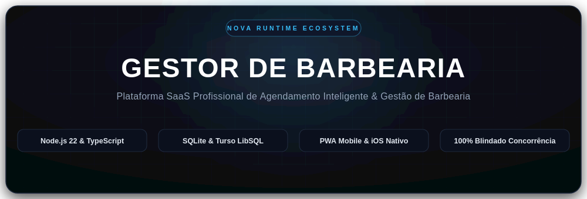

<div align="center">

  

  <br />
  <br />

  ### Plataforma SaaS Profissional de Gestão de Barbearia, Agendamento Inteligente & PWA Mobile de Alta Performance

  <p align="center">
    <a href="https://nodejs.org"></a>
    <a href="https://www.typescriptlang.org"></a>
    <a href="https://sqlite.org"></a>
    <a href="https://turso.tech"></a>
    <a href="https://web.dev/progressive-web-apps/"></a>
    <br />
    <a href="https://apple.com/safari"></a>
    
    
    <a href="https://getfedora.org"></a>
  </p>

</div>

---

## ⚡ O que há de novo (Últimas Atualizações)

Nesta versão, a plataforma recebeu um redesign completo de interface e otimizações arquiteturais para eliminar qualquer aspecto artificial ("visual de IA"), trazendo acabamento de software de alto padrão:

* **🎨 Redesign Minimalista Obsidian Noir (Sem efeito de IA)**:
  * Paleta escura autêntica com degradê sutil em preto profundo (`radial-gradient(120% 80% at 50% 0%, #151821 0%, #0A0C10 45%, #050608 100%)`).
  * Eliminação de elementos cafonas: remoção de emojis exagerados, bolinhas numeradas de wizard e tons amarelos/dourados saturados.
  * Cards de serviços em linha única com espaçamento generoso, tipografia legível, tag discreta de duração e feedback tátil.
  * Barra de progresso minimalista em 4 segmentos finos (estilo stories/Apple).

* **📱 Experiência de App Nativo no Celular (PWA & iOS Safari)**:
  * Suporte a instalação como aplicativo na tela inicial do celular com ícones PNG de alta resolução (`apple-touch-icon.png`, `icon-192.png`, `icon-512.png`).
  * **Modal nativo para iPhone (Safari)**: Guia passo a passo em 3 etapas para adicionar à tela de início sem atrito.
  * **PWA com Service Worker**: Cache inteligente com estratégia *Stale-While-Revalidate* para carregamento instantâneo e funcionamento offline da casca visual.

* **🛡️ Tipagem TypeScript Estrita (`strict: true`)**:
  * Contratos de domínio e respostas tipadas em `server/types.ts`.
  * Validação com `npm run typecheck` com 0 erros.

* **⚡ Teste de Carga & Concorrência Atômica (50 Usuários)**:
  * Simulação automatizada de 50 conexões simultâneas disparando 200 requisições HTTP (`npm run test:stress`).
  * Vazão de **~1.575 req/s** e latência média de **30.9 ms** com **0 falhas (erros 500)**.
  * **Garantia atômica contra agendamento duplicado**: Em disputas pelo exato mesmo horário e profissional, 1 agendamento é aprovado (201) e 24 são bloqueados com integridade (409 Conflict).

---

## Capturas de tela

Todas as imagens abaixo são capturas reais da aplicação rodando em **modo demonstração** com o novo visual:

### Página pública de agendamento (Celular & PWA)


### Painel — Dashboard


### Agenda


### Relatórios


### Clientes


### Acesso ao painel


---

## Funcionalidades

**Agenda e agendamentos**
- Agenda diária e semanal, com filtro por profissional.
- Criação, edição, confirmação, conclusão e cancelamento de agendamentos.
- **Bloqueio de agendamentos duplicados** no mesmo horário e profissional — garantido por uma instrução SQL atômica e por um índice único parcial no próprio banco, o que evita condições de corrida mesmo com acessos simultâneos.
- Controle de horários de funcionamento, jornada de cada profissional, pausas e folgas.
- Cálculo automático do horário de término com base na duração do serviço.

**Cadastros**
- Clientes (com busca por nome/telefone), profissionais (cor, comissão, jornada) e serviços (duração e preço).

**Financeiro e relatórios**
- Dashboard com agenda do dia, receita prevista e realizada, ocupação dos profissionais e serviços mais procurados.
- Relatórios por período, com totais, comissão por profissional e distribuição por dia da semana.

**Página pública de agendamento e autoatendimento**
- Fluxo minimalista em 4 passos (serviço → profissional → horário → dados), pensado prioritariamente para o celular.
- Só exibe horários realmente livres; respeita folgas e dias fechados.
- **Link exclusivo de autoatendimento (`cancel_token`)**: cada agendamento gera um token criptográfico de 128 bits que permite ao cliente consultar o status ou cancelar o horário diretamente (`/agendar?manage=<token>`), liberando a vaga imediatamente sem risco de IDOR.
- Botão de contato direto no **WhatsApp** e link para o telefone da barbearia no rodapé discreto.
- Pode ser desativada a qualquer momento nas configurações.

**WhatsApp**
- Mensagens prontas de confirmação, lembrete e cancelamento, geradas a partir do agendamento e abertas no WhatsApp com um clique.
- Suporte ao marcador `{link_cancelamento}` para enviar o link direto de autoatendimento ao cliente.

**Operação & PWA**
- Instalação na tela inicial (PWA) em celulares iOS e Android.
- Backup exportável/importável em JSON (modos *mesclar* e *substituir*).
- Health check em `/health` para monitoramento e deploy.
- Modo demonstração com dados fictícios (`npm run demo`).

---

## Tecnologias

| Camada | Escolha | Motivo |
| --- | --- | --- |
| Runtime | Node.js 22.5+ | `node:sqlite` nativo, sem compilações externas |
| Tipagem / Tipos | TypeScript (Strict) | Tipagem estrita de contratos de domínio (`server/types.ts`) e validação via `npm run typecheck` |
| Backend | HTTP nativo (`node:http`) + módulos ES | Rápido, leve, sem overhead de frameworks |
| Frontend | HTML + CSS + JavaScript (módulos ES) | SPA nativa com design tokens Obsidian & Titanium e alta performance |
| Mobile / PWA | Web App Manifest & Service Worker | Ícone na tela inicial, cache estático e modo standalone sem barra do navegador |
| Banco (local) | SQLite via `node:sqlite` | Zero configuração |
| Banco (produção) | Turso / libSQL via `@libsql/client` | Persistência real no plano gratuito do Render |
| Segurança | `node:crypto` (scrypt, HMAC-SHA256) | Criptografia forte para senhas e sessões |
| Hospedagem | Render (plano gratuito) | HTTPS e domínio `*.onrender.com` inclusos |

A escolha do banco é automática: se a variável `TURSO_DATABASE_URL` estiver definida, o sistema usa o Turso; caso contrário, usa SQLite local. O mesmo código atende desenvolvimento e produção.

---

## Instalação local

Requisitos: **Node.js 22.5 ou superior**.

```bash
git clone git@github.com:BrunoRafa01/gestor-de-barbearia.git
cd gestor-de-barbearia
npm install
cp .env.example .env      # ajuste a senha do painel em ADMIN_PASSWORD
npm start
```

Acesse:

- Painel: <http://localhost:3000/>
- Agendamento público: <http://localhost:3000/agendar>

Na primeira execução o banco é criado em `data/barbearia.db` e a senha do painel passa a ser a de `ADMIN_PASSWORD` (ou `admin123`, se você não definir). **Troque a senha em Configurações → Segurança** no primeiro acesso — o painel exibe um aviso até isso ser feito.

Para acessar pelo celular na mesma rede Wi-Fi, o `npm start` mostra o endereço no banner (ex: `http://172.16.100.28:3000/agendar`).

---

## Modo demonstração

Apresenta o sistema com **dados fictícios**, em um banco separado (`data/demo.db`), sem tocar em nenhum dado real:

```bash
npm install
npm run demo
```

A interface mostra o selo *Modo demonstração* no painel e na página pública. Barbeiros, clientes e agendamentos são gerados automaticamente e **não representam pessoas reais**.

---

## Testes e Verificação de Tipos

```bash
npm run typecheck       # Verificação estrita de tipos com TypeScript (tsc --noEmit)
npm test                # 138 verificações end-to-end (API, regras de negócio, cancelamento seguro e segurança)
npm run test:turso      # 21 verificações de persistência com libSQL (sobrevive a reinício)
npm run test:responsive # 10 verificações de conformidade mobile (touch targets >= 44px, safe area)
npm run test:stress     # Simulação de carga com 50 usuários simultâneos (200 requisições paralelas)
npm run test:all        # Executa todas as suites de testes e validação de tipos
```

---

## Variáveis de ambiente

| Variável | Obrigatória | Descrição |
| --- | --- | --- |
| `PORT` | não | Porta HTTP (padrão `3000`; o Render define automaticamente). |
| `HOST` | não | Interface de rede (padrão `0.0.0.0`). |
| `ADMIN_PASSWORD` | não | Senha inicial do painel. Se ausente, usa `admin123`. |
| `DATABASE_PATH` | não | Caminho do arquivo SQLite local. |
| `TURSO_DATABASE_URL` | em produção | URL do banco Turso (`libsql://...`). |
| `TURSO_AUTH_TOKEN` | em produção | Token de acesso do Turso. |
| `DEMO_MODE` | não | `1` ativa o modo demonstração com dados fictícios. |

Nunca coloque senhas ou tokens dentro do código. O arquivo `.env` é ignorado pelo Git; todas as credenciais de produção ficam nas variáveis de ambiente do Render.

---

## Deploy gratuito (Render + Turso)

O passo a passo completo está em **[DEPLOY.md](DEPLOY.md)**. Resumo:

1. Crie um banco gratuito no [Turso](https://turso.tech) e copie a URL e o token.
2. Envie o projeto para o GitHub.
3. No [Render](https://render.com), use **New → Blueprint** e aponte para o repositório (o arquivo [`render.yaml`](render.yaml) já descreve o serviço).
4. Informe `TURSO_DATABASE_URL` e `TURSO_AUTH_TOKEN` quando solicitado.
5. O Render entrega HTTPS e um domínio gratuito no formato `https://SEU-APP.onrender.com`.

### Atualizando o sistema depois de publicado

O serviço está configurado com `autoDeploy`. Para publicar uma alteração:

```bash
git add .
git commit -m "Descrição da melhoria"
git push origin main
```

O Render detecta o push, reconstrói e publica sozinho. Como os dados ficam no **Turso** (e não no disco do Render), **nenhum cliente, profissional ou agendamento é perdido** nos deploys e reinícios.

---

## Segurança

- Senha do painel com **scrypt** (salt aleatório) e comparação em tempo constante.
- Sessão assinada com **HMAC-SHA256**, em cookie `HttpOnly`, `SameSite=Lax` e `Secure` quando servido por HTTPS.
- **Proteção CSRF / Origin Validation** em todas as requisições mutantes (`POST`, `PUT`, `PATCH`, `DELETE`).
- **Ocultação de detalhes internos em produção**: erros e exceções não vazam stack traces ou schemas internos (`NODE_ENV=production`).
- Cabeçalhos de segurança: `Content-Security-Policy`, `Strict-Transport-Security`, `X-Frame-Options`, `X-Content-Type-Options` e `Referrer-Policy`.
- **Rate limiting** por IP no login e nos endpoints públicos de agendamento.
- Validação e normalização de todas as entradas na API.
- Segredos nunca aparecem nas respostas nem no backup.

---

## Estrutura do projeto

```
.
├── public/                 # Front-end (sem build) servido pelo próprio Node
│   ├── css/app.css         # Tema minimalista Obsidian & Titanium
│   ├── js/app.js           # Painel (SPA com roteamento por hash)
│   ├── js/agendar.js       # Página pública de agendamento mobile PWA
│   ├── manifest.json       # Manifesto Web App (PWA)
│   ├── sw.js               # Service Worker de cache e modo offline
│   ├── apple-touch-icon.png# Ícone nativo para iOS Safari
│   ├── icon-192.png        # Ícone PWA Android
│   ├── icon-512.png        # Ícone PWA splash screen
│   └── index.html, agendar.html, 404.html
├── server/                 # Back-end
│   ├── server.js           # Servidor HTTP, roteador e banner
│   ├── types.ts            # Contratos de domínio e tipagem estrita TypeScript
│   ├── db.js               # Driver duplo: node:sqlite / Turso (libSQL)
│   ├── availability.js     # Regras de horários, folgas e conflitos
│   ├── appointments.js     # Regras de negócio dos agendamentos
│   ├── auth.js             # Sessão, senha e autenticação
│   ├── security.js         # Cabeçalhos, rate limit e detecção de proxy
│   ├── demo.js             # Dados fictícios do modo demonstração
│   └── routes/             # Endpoints da API, por domínio
├── scripts/
│   ├── demo.mjs            # Atalho para iniciar em modo demonstração
│   ├── generate-icons.mjs  # Gerador de ícones PNG para PWA e iOS
│   ├── stress-test.mjs     # Teste de estresse com 50 usuários simultâneos
│   └── capture-all-screenshots.mjs # Captura automatizada das telas oficiais
├── tests/                  # Testes end-to-end, persistência e responsividade
├── docs/screenshots/       # Capturas de tela e banner usados neste README
├── tsconfig.json           # Configuração de checagem TypeScript
├── render.yaml             # Blueprint de deploy no Render
└── .env.example            # Modelo das variáveis de ambiente
```

---

## Licença

Desenvolvido por **Bruno**. Todos os direitos reservados.
